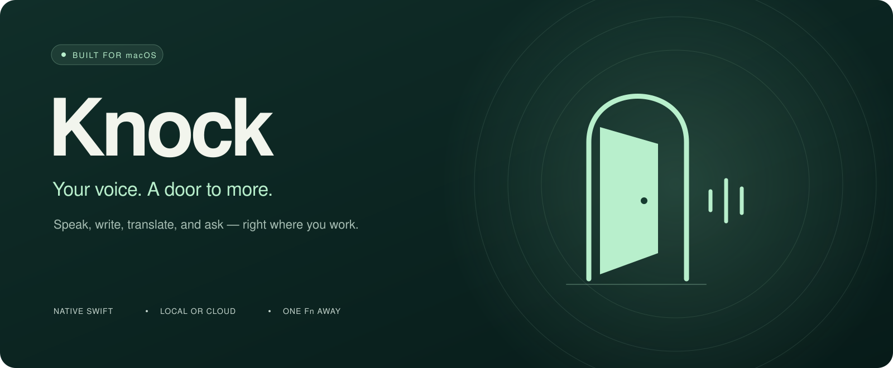
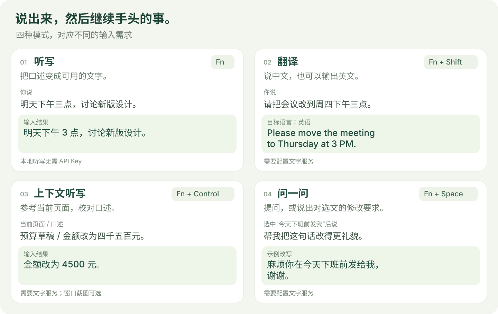
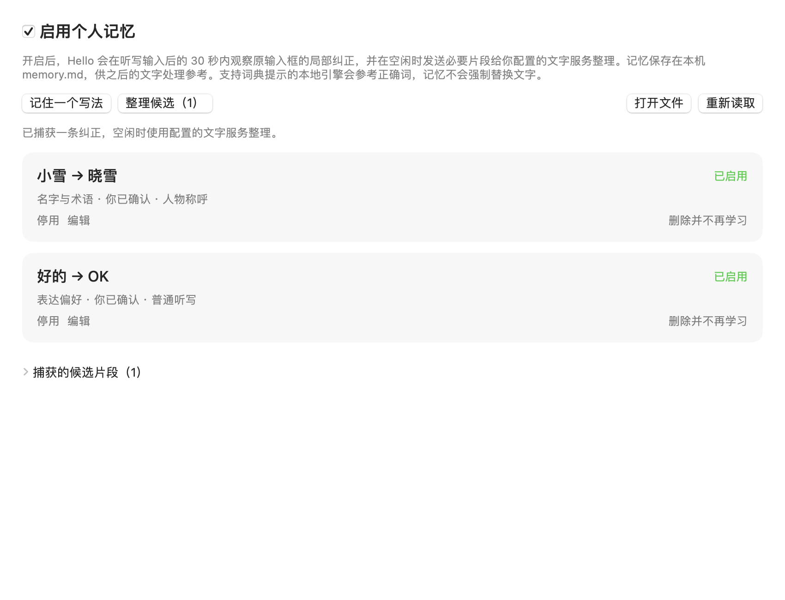
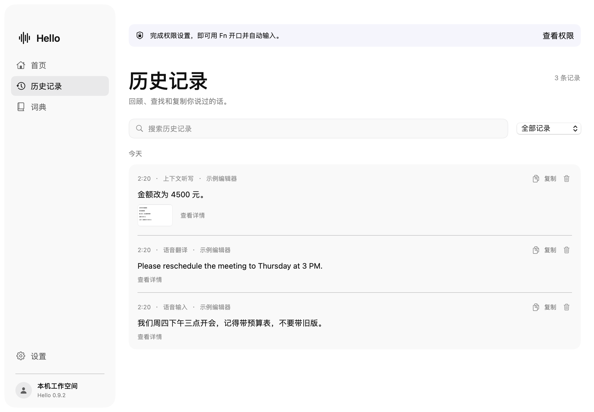

<p align="center">
  
</p>
<p align="center">
  <a href="https://github.com/Yikehaodan/Hello/actions/workflows/checks.yml"></a>
  
  
  
</p>
<p align="center"><strong>开口，说声 Hello。</strong><br/>在你正在使用的应用里，听写、翻译、提问。</p>
<p align="center">
  <a href="https://github.com/Yikehaodan/Hello/releases/download/v0.9.3/Hello-0.9.3-macOS-arm64.dmg"></a>
</p>
<p align="center"><sub>Apple Silicon · macOS 14+ · 公开预览版 · 尚未经过 Apple 公证</sub></p>
<p align="center"><a href="#92-秒看-hello-怎么用">观看演示</a> · <a href="#四种方式用声音完成输入">功能介绍</a> · <a href="#下载安装">下载安装</a> · <a href="docs/INSTALL.md">安装帮助</a> · <a href="https://github.com/Yikehaodan/Hello/releases/latest">版本记录</a></p>

Hello 是一款 macOS 语音工具。把光标放在输入框，轻按 `Fn` 开始说话，再按一次，识别后的文字就会填入原来的位置。写消息、记想法、组织长段文字，都可以从开口开始。

## 92 秒，看 Hello 怎么用

改口后的会议时间，直接写成英文的消息，难认准的项目名和姓名，催得太生硬的话，还有每次都要改的“小雪”。五个场景展示 Hello 怎样帮你少改几遍。

https://github.com/user-attachments/assets/3470dc33-b43c-4236-a57d-f22b6f2c7b73

<p align="center"><a href="https://github.com/Yikehaodan/Hello/releases/download/v0.9.3/Hello-Demo-Shotcraft-1080p.mp4">下载 1080p 视频</a></p>
<p align="center"><sub>1 分 32 秒 · 无配音、无字幕 · 关键操作放大聚焦。画面保留原生界面与示例文本，等待时间已压缩；实际输出取决于模型和服务。</sub></p>

## 四种方式，用声音完成输入

<p align="center"></p>
<p align="center"><sub>功能示意，示例输出用于说明用法；实际结果取决于所选模型与服务。</sub></p>

| 功能 | 快捷键 | 用法 |
| --- | --- | --- |
| 听写 | `Fn` | 把口述变成文字。可开启自动整理，处理标点、重复和改口。 |
| 翻译 | `Fn + Shift` | 用熟悉的语言说话，按设定的目标语言输出。 |
| 上下文听写 | `Fn + Control` | 参考当前输入框和可选的窗口截图，校对口述中的术语、姓名与数字。 |
| 问一问 | `Fn + Space` | 直接提问并查看回答；也可以选中文字，再说出改写要求。 |

再次按 `Fn` 结束录音，`Esc` 取消。`Control + Command + V` 输入上次结果。每次录音最多 2 分钟。改写选文时，Hello 会检查原来的选区是否仍可写入；无法写入时可手动复制结果。

**普通本地听写无需 API Key。** 自动整理、翻译、上下文听写和问答需要配置文字服务，截图校对还需要服务支持图片输入。配置方法见[服务配置](docs/SETUP.md#文字服务)。

### 常用的词和说过的话，也能留下来

把人名、产品名和专业词加入个人词典，供文字处理时参考。历史记录支持搜索、查看识别原文、回放录音和重新处理；可用内容取决于本机保留设置。

**个人记忆会学习你纠正过的写法。** 例如把“小雪”改成“晓雪”，相同纠正在不同听写中重复出现后，Hello 会把它作为人名参考。“好的 → OK”这类表达偏好需要你确认后启用。记忆保存在本机 `memory.md`，可查看、编辑和删除。

在“词典 → 个人记忆”中开启，默认关闭。自动捕获取决于输入框是否支持读取，也可以手动添加。具体规则见[个人记忆说明](docs/MEMORY.md)。

<details>
<summary>查看个人记忆界面</summary>

<p align="center"></p>
<p align="center"><sub>v0.9.3 实际应用视图，使用演示数据。</sub></p>

</details>

<details>
<summary>查看历史记录界面</summary>

<p align="center"></p>
<p align="center"><sub>v0.9.2 实际应用视图，使用演示数据。</sub></p>

</details>

## 下载安装

**[下载 Hello v0.9.3（macOS 安装包）](https://github.com/Yikehaodan/Hello/releases/download/v0.9.3/Hello-0.9.3-macOS-arm64.dmg)**

支持 Apple Silicon Mac（M 系列芯片），需要 macOS 14 或更新版本。界面为简体中文。目前不支持 Intel Mac、Windows 和 Linux。

1. 打开下载的 DMG，将 `Hello.app` 拖到 `Applications`，再从“应用程序”启动。
2. 按首次引导设置麦克风与辅助功能权限。屏幕录制仅用于可选的窗口截图。
3. 在“设置 → 语音模型”中下载并选择模型。中文听写可以先用 Zipformer；其他模型见[模型说明](docs/MODELS.md)。
4. 把光标放入输入框，轻按 `Fn`，开始第一次听写。

安装包已包含运行组件，无需安装开发工具。模型权重按需下载，支持暂停、继续和校验。需要翻译等功能时，在“设置 → 服务配置”填写你自己的 API Key。文字服务默认使用 DeepSeek 官方，也支持自定义服务；保存前可点击“测试连接”。

**当前版本使用临时签名，尚未经过 Apple 公证。** 首次打开若被系统阻止，确认下载来源并信任此版本后，可在“系统设置 → 隐私与安全性”中找到 Hello，点击“仍要打开”。具体步骤见[安装帮助](docs/INSTALL.md)。

更新时先退出旧版，再用新版替换应用。本机模型、词典和历史会保留；系统可能要求重新授予权限。从 Knock 升级的说明也在[安装帮助](docs/INSTALL.md#更新与卸载)中。

## 权限与数据

| 权限 | 用途 |
| --- | --- |
| 麦克风 | 主动开始录音后收音。 |
| 辅助功能 | 使用全局快捷键、读取输入框或选文，并写回文字。 |
| 屏幕录制，可选 | 上下文听写时获取当前窗口截图；新安装默认关闭截图。 |

本地语音模型在 Mac 上处理录音。选择云端语音后，录音会发送到对应服务。使用文字服务时，相关文字会发送到你配置的服务；上下文听写还可能发送输入框内容、窗口标题和截图。

开启个人记忆后，Hello 会在听写后的 30 秒内观察原输入框的局部修改，并把必要片段交给配置的文字服务整理。记忆独立于历史记录保留，可在个人记忆页管理。

权限可以之后在设置中补充，详细用途、未授权时的用法和数据保留说明见[权限与数据](docs/PERMISSIONS.md)。

## 帮助与反馈

- [安装与更新](docs/INSTALL.md)：首次打开、版本替换、下载文件校验。
- [模型管理](docs/MODELS.md)：选择模型、下载失败、导入已有权重。
- [服务配置](docs/SETUP.md#文字服务)：接入文字服务和可选的云端语音。
- [个人记忆](docs/MEMORY.md)：捕获纠正、确认偏好和管理本机记忆。
- [反馈问题](https://github.com/Yikehaodan/Hello/issues)：请附 macOS 版本、芯片型号、模型和复现步骤，勿附密钥或私人录音。

Hello 希望成为人与 Agent 交流的入口，当前版本专注于语音输入与问答。

## 从源码构建

需要 Apple Silicon Mac、macOS 14+、Xcode 命令行工具、CMake 和 Python 3.9+。

```sh
git clone https://github.com/Yikehaodan/Hello.git
cd Hello
zsh scripts/setup.sh
```

构建、测试和打包方法见[开发文档](docs/SETUP.md)，第三方组件说明见 [THIRD_PARTY_NOTICES.md](THIRD_PARTY_NOTICES.md)。
