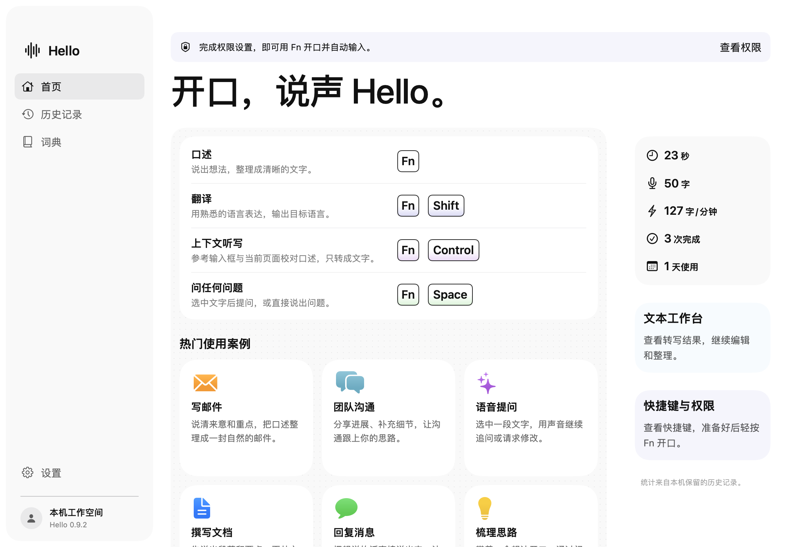
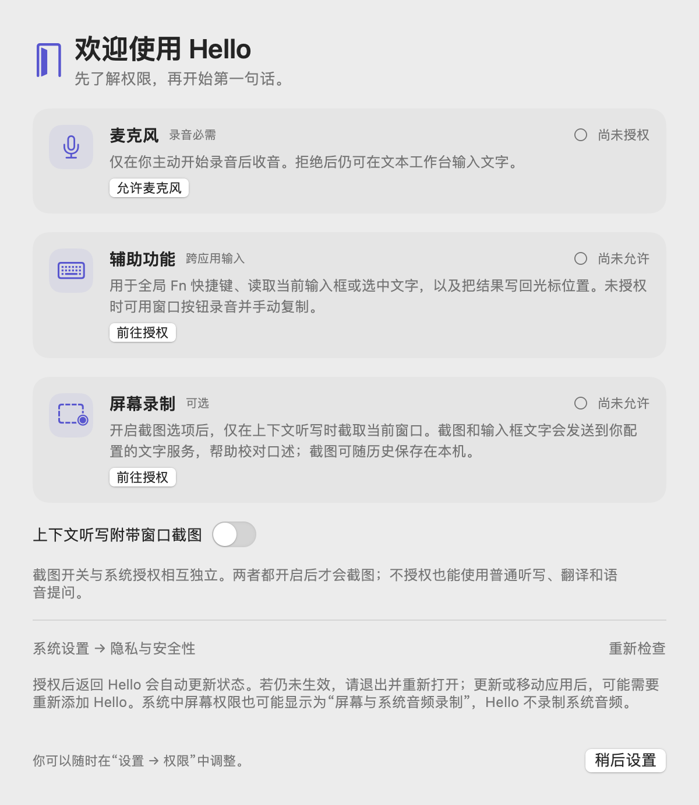

<p align="center">
  
</p>
<p align="center">
  <a href="https://github.com/Yikehaodan/Hello/actions/workflows/checks.yml"></a>
  
  
  
</p>
<p align="center"><strong>开口，说声 Hello。</strong><br/>把声音带进你正在使用的应用。</p>
<p align="center">
  <a href="https://github.com/Yikehaodan/Hello/releases/download/v0.9.2/Hello-0.9.2-macOS-arm64.dmg"></a>
</p>
<p align="center"><sub>Apple Silicon · macOS 14+ · 公开预览版 · 尚未经过 Apple 公证</sub></p>
<p align="center"><a href="docs/INSTALL.md">安装指引</a> · <a href="https://github.com/Yikehaodan/Hello/releases/latest">版本记录</a> · <a href="#开始使用">开始使用</a> · <a href="docs/SETUP.md">构建与配置</a> · <a href="docs/PERMISSIONS.md">macOS 权限</a> · <a href="docs/MODELS.md">本地模型</a></p>

## 一句话，接着做

Hello 是一个原生 macOS 语音工具。轻按 Fn，说出想法，再按一次，文字就会回到光标所在的位置。它希望成为人与 Agent 之间的入口，目前提供听写、翻译、上下文听写和语音问答。

**目前仅支持 Apple Silicon Mac，系统要求 macOS 14 或更新版本。** 界面使用简体中文。Intel Mac、Windows 和 Linux 暂不支持。

| 你想做什么 | 快捷键 | Hello 会做什么 |
| --- | --- | --- |
| 口述文字 | `Fn` | 把声音转成文字，可整理标点、重复和改口 |
| 换一种语言表达 | `Fn + Shift` | 将完整口述翻译成目标语言 |
| 结合正在看的页面听写 | `Fn + Control` | 参考当前输入框和可选截图，校对口述 |
| 提问或修改选中文字 | `Fn + Space` | 显示回答，或在条件允许时替换选中文字 |

再次按 `Fn` 结束录音，`Esc` 取消。`Control + Command + V` 输入上次结果。每次录音最多 2 分钟。

<p align="center"></p>
<p align="center"><sub>实际 SwiftUI 视图渲染，使用演示数据。</sub></p>

## 开始使用

Hello 原名 Knock。从旧版升级会保留本机数据与模型，详见[安装指引](docs/INSTALL.md)。

### 直接下载安装

**[下载 Hello v0.9.2 安装包（DMG）](https://github.com/Yikehaodan/Hello/releases/download/v0.9.2/Hello-0.9.2-macOS-arm64.dmg)** · [查看 Release 与校验文件](https://github.com/Yikehaodan/Hello/releases/tag/v0.9.2)

1. 打开 DMG，把 `Hello.app` 拖入 `Applications`，从“应用程序”启动。
2. 按首次引导设置麦克风与辅助功能权限。屏幕录制可选。
3. 在“设置 → 语音模型”中下载并选择一个模型。中文听写可先选 Zipformer，多语言可选 Whisper 或 SenseVoice。
4. 在任意输入框轻按 `Fn`，开始第一句话。

安装包自带运行组件，无需开发工具。**此版本使用临时签名，尚未经过 Apple 公证。** 首次打开若被系统阻止，确认来源并信任此版本后，可在“系统设置 → 隐私与安全性”中找到 Hello，点击“仍要打开”。详见[安装指引](docs/INSTALL.md)。

模型权重按需下载。没有配置文字服务时，自动整理默认关闭，普通本地听写可先使用。翻译、问答和上下文听写需要在“设置 → 服务配置”填写服务地址、API Key 与模型名称。服务必须兼容 Chat Completions；截图校对还需要支持图片输入。

### 从源码构建

需要 Xcode 命令行工具、CMake 和 Python 3.9 或更新版本。

```sh
git clone https://github.com/Yikehaodan/Hello.git
cd Hello
zsh scripts/setup.sh
```

脚本先检查依赖，再构建 `Hello.app`。缺少依赖时会给出安装方法。首次构建需要访问 GitHub 和 PyPI；下载缓存可供下次构建复用，不会修改系统 Python 包。详见[构建与配置](docs/SETUP.md)。

## 让模型适合你的 Mac

| 模型 | 适用场景 | 模型大小 |
| --- | --- | --- |
| Zipformer | 中文，边录边识别 | 约 167 MB |
| SenseVoice | 中、英、日、韩和粤语 | 约 240 MB |
| Whisper | 本地多语言听写 | 约 574 MB |
| Qwen3-ASR 0.6B | 本地多语言识别 | 约 1.88 GB |
| Qwen3-ASR 轻量版 | 本地量化版本 | 约 542 MB，首次需下载约 1.88 GB 再转换 |
| 豆包云端 | 联网流式识别 | 需单独配置服务密钥 |

模型在应用内按需下载，支持暂停、继续和文件校验。可用命令行提前下载、校验或导入已有权重。下载失败不会把不完整的文件标记为可用。详见[模型管理](docs/MODELS.md)。

## 权限有用途，数据有去向

| 权限 | 用途 | 未授权时 |
| --- | --- | --- |
| 麦克风 | 主动开始录音后收音 | 可使用文本工作台 |
| 辅助功能 | 全局快捷键、读取输入框或选文、写回文字 | 可用窗口按钮录音，手动复制结果 |
| 屏幕录制，可选 | 上下文听写时截取当前窗口 | 普通听写、翻译和提问仍可使用 |

新安装默认关闭窗口截图。开启截图选项并获得系统授权后，上下文听写才会截图。权限引导可跳过，之后从“设置 → 权限”继续配置。

<p align="center"></p>

本地模型在 Mac 上处理录音。选择云端语音后，录音会发送到对应服务。自动整理、翻译和问答会将相关文字发送到配置的文字服务；上下文听写还可能发送当前输入框、窗口标题和截图。历史、录音和截图按本机保留设置保存。

完整说明见[权限与数据](docs/PERMISSIONS.md)。

## 已经能做什么

- 原生菜单栏应用、录音浮条、浅色与深色外观。
- 本地或云端识别、个人词典、跨应用文字输入。
- 搜索历史、查看识别原文、录音回放与重新处理。
- 权限状态检查、首次使用引导、可配置的文字服务。

Agent 入口是产品方向。当前版本没有通用任务执行、任意电脑操作或多 Agent 编排能力。问答中的联网搜索需要额外配置适配服务；天气查询使用 Open-Meteo。

## 开发

```sh
zsh scripts/doctor.sh   # 检查构建环境
zsh source/build.sh     # 增量构建
zsh scripts/test.sh     # 隔离测试，不需要真实密钥、麦克风或大模型
zsh scripts/package.sh  # 构建 DMG 安装包与 SHA-256 校验文件
```

源码位于 `source/`，测试位于 `tests/`。模型来源、文件大小和 SHA-256 校验值记录在 `source/speech-runtime/models.json`。运行组件与第三方代码的许可说明见 [THIRD_PARTY_NOTICES.md](THIRD_PARTY_NOTICES.md)。

提交问题时请附 macOS 版本、芯片型号、选用模型和复现步骤，勿附 API Key、私人录音或未经处理的窗口截图。
